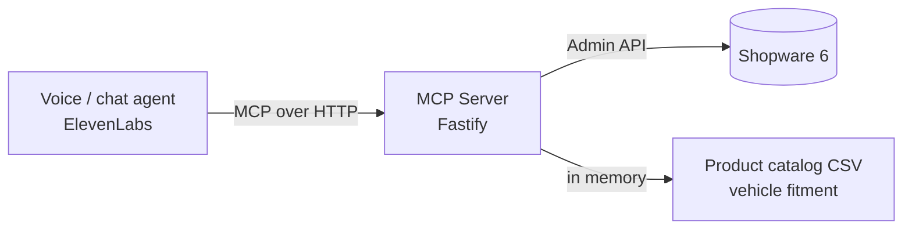

<div align="center">

# Weltmann Shopware MCP Server

**AI customer support for a Shopware 6 auto parts shop: order tracking, payment checks, customer lookup and vehicle-specific part search.**

[](https://nodejs.org)
[](https://www.typescriptlang.org)
[](https://fastify.dev)
[](https://modelcontextprotocol.io)
[](https://zod.dev)
<br>
[](https://developer.shopware.com)
[](https://elevenlabs.io/docs/eleven-agents/customization/tools/mcp)
[](https://pm2.keymetrics.io)
[](https://opensource.org/licenses/ISC)

</div>

---

## Overview

This server connects AI assistants, such as an ElevenLabs voice agent, to a Shopware 6 shop over the [Model Context Protocol](https://modelcontextprotocol.io) (MCP). Customers can ask about their orders, payments and parts. The agent answers using live shop data.



## Features

- 🚚 **Order tracking**: shipping status, tracking codes and delivery estimates
- 💳 **Payment checks**: payment status and method in plain language
- 👤 **Customer lookup**: by email, phone, name or customer number
- 🔧 **Part finder**: search by part name and vehicle brand, model and variant
- 📦 **Stock checks**: live inventory from Shopware
- 🌍 **Language-independent statuses**: uses Shopware's fixed state codes, so admin language does not matter
- 🔐 **Security**: optional API key, rate limiting, sanitized error messages
- 📖 **REST + Swagger docs** alongside the MCP endpoint

## MCP Tools

| Area | Tool | What it does |
|------|------|--------------|
| Orders | `search-orders` | Find an order by number, or list recent orders |
| | `check-order-status` | Customer-friendly shipping status and delivery estimate |
| | `check-payment-status` | Payment status and payment method |
| | `get-order-items` | Items in an order |
| Customers | `search-customer` | Find a customer by phone, email, name or customer number |
| | `get-customer-orders` | Order history for a customer |
| Products | `search-product-catalog` | Search part names, filtered by vehicle brand, model and variant |
| | `search-product-number` | Look up a product by its SKU |
| | `get-stock-level` | Check availability |

All tools are read-only.

## Quick Start

**Requirements:** Node.js 20 or newer, and a Shopware 6 shop with an Admin API integration.

```bash
git clone https://github.com/pradhankukiran/weltmann-shopware-mcp.git
cd weltmann-shopware-mcp
npm install
# create .env (see Configuration below)
npm run build
npm start
```

For development with auto-reload:

```bash
npm run dev
```

## Configuration

Create a `.env` file in the project root.

```env
# Server
PORT=3000
SERVER_HOST=127.0.0.1
NODE_ENV=production

# Shopware Admin API
SHOPWARE_API_URL=https://your-shop.com/api
SHOPWARE_ACCESS_KEY_ID=your-access-key
SHOPWARE_SECRET_ACCESS_KEY=your-secret-key

# Security (strongly recommended in production)
MCP_API_KEY=your-secure-api-key
```

<details>
<summary><b>All optional settings</b></summary>

| Variable | Default | Description |
|----------|---------|-------------|
| `SHOPWARE_API_TIMEOUT` | `10000` | Shopware request timeout (ms) |
| `DEFAULT_PAGE_SIZE` | `10` | Default results per page |
| `MAX_PAGE_SIZE` | `250` | Max results per Shopware request |
| `MAX_PAGINATION_ITERATIONS` | `100` | Safety cap on pages fetched |
| `MAX_TOTAL_ITEMS` | `25000` | Safety cap on total items fetched |
| `HEALTH_CHECK_PRODUCT_NUMBER` | `JA-000001` | Product used by `/health` to test Shopware |
| `RATE_LIMIT_WINDOW_MS` | `60000` | Rate limit window (ms) |
| `RATE_LIMIT_MAX_REQUESTS` | `100` | Requests allowed per window per IP |
| `CORS_ORIGIN` | _unset_ | Enable CORS for this origin (`*` for any) |
| `MCP_ORDER_DISPLAY_LIMIT` | `10` | Orders shown in a tool reply |
| `MCP_PRODUCT_DISPLAY_LIMIT` | `10` | Products shown in a tool reply |
| `MCP_CUSTOMER_SEARCH_LIMIT` | `50` | Max customers returned by a search |

</details>

### Shopware integration

1. In the Shopware admin, go to **Settings → System → Integrations**.
2. Create an integration with read access to products, orders and customers.
3. Copy the Access Key ID and Secret Access Key into `.env`.

### Product catalog

Vehicle fitment data comes from `data/weltmannproducts.csv`, loaded into memory at startup. Restart the server after replacing the file.

```csv
productNumber,productName,vehicleBrand,vehicleModel,vehicleVariant
JA-000401,JAEGER automotive 7P Elektrosatz,BMW,5er,"Typ G30, Limousine"
```

## Connect to ElevenLabs

1. In your ElevenLabs workspace, enable MCP servers (accept the MCP Server Terms).
2. Add a custom MCP server:
   - **Server URL:** `https://your-server.com/mcp`
   - **Transport:** Streamable HTTP
   - **Secret token:** your `MCP_API_KEY` (sent as the `Authorization` header)
3. Choose a tool approval mode. All tools are read-only, so auto-approval is safe.
4. Attach the server to your agent.

> [!NOTE]
> ElevenLabs does not offer MCP in Zero Retention Mode or HIPAA workspaces.

## API Endpoints

| Method | Path | Description |
|--------|------|-------------|
| `POST` | `/mcp` | MCP endpoint (stateless, Streamable HTTP) |
| `GET` | `/health` | Health check, including Shopware connectivity |
| `GET` | `/docs` | Swagger UI |
| `GET` | `/v1/products/search` | REST product search |
| `GET` | `/v1/orders/search` | REST order search |

### Example MCP request

```bash
curl -X POST http://localhost:3000/mcp \
  -H "Content-Type: application/json" \
  -H "Accept: application/json, text/event-stream" \
  -H "X-API-Key: your-api-key" \
  -d '{
    "jsonrpc": "2.0",
    "id": 1,
    "method": "tools/call",
    "params": {
      "name": "check-order-status",
      "arguments": { "orderNumber": "10001" }
    }
  }'
```

## Deployment

### PM2

```bash
npm install -g pm2
npm run build
npm run pm2:start
pm2 save && pm2 startup   # start on reboot
```

| Command | Action |
|---------|--------|
| `npm run pm2:status` | Show status |
| `npm run pm2:logs` | Show logs |
| `npm run pm2:restart` | Restart |
| `npm run pm2:stop` | Stop |

### Deploy script

```bash
./deploy.sh
```

Installs dependencies, builds, and starts or restarts the PM2 process.

## Project Structure

```
weltmann-shopware-mcp/
├── src/
│   ├── index.ts              # Server entry point and /health
│   ├── config.ts             # Environment validation (Zod)
│   ├── plugins/
│   │   ├── mcp.ts            # MCP tools and /mcp endpoint
│   │   ├── shopware.ts       # Shopware client plugin
│   │   ├── csv.ts            # Product catalog loader
│   │   ├── security.ts       # API key auth and rate limiting
│   │   └── swagger.ts        # API docs
│   ├── routes/               # REST endpoints
│   ├── shopware/
│   │   └── adminClient.ts    # Admin API client (OAuth, retries)
│   ├── types/                # Shopware types
│   └── utils/                # Helpers
├── data/
│   └── weltmannproducts.csv  # Vehicle fitment catalog
├── deploy.sh
└── ecosystem.config.js       # PM2 config
```

## Troubleshooting

<details>
<summary><b>Shopware connection fails</b></summary>

- Make sure `SHOPWARE_API_URL` ends with `/api`.
- Check the integration credentials.
- Check the integration has read access to products, orders and customers.
</details>

<details>
<summary><b>MCP endpoint returns 401</b></summary>

- Send your `MCP_API_KEY` in an `X-API-Key` header or as `Authorization: Bearer <key>`.
</details>

<details>
<summary><b>MCP endpoint returns 406</b></summary>

- Send the header `Accept: application/json, text/event-stream`.
</details>

<details>
<summary><b>Products not found</b></summary>

- Check `data/weltmannproducts.csv` exists and has the right headers.
- Restart the server after changing the file.
</details>

## License

[ISC](https://opensource.org/licenses/ISC)
